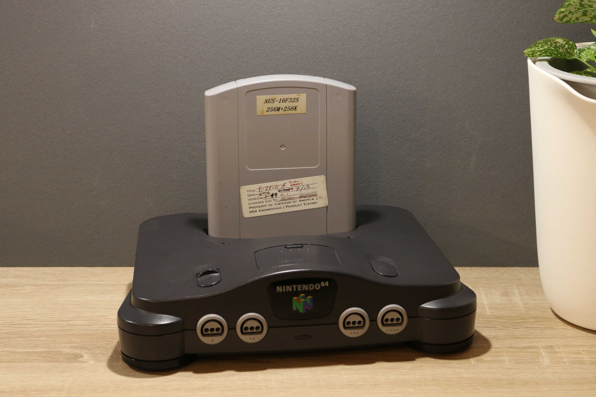
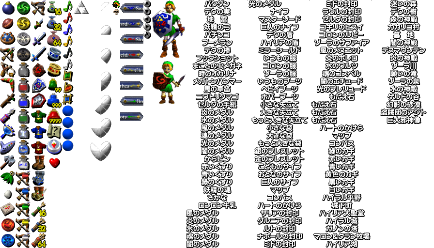
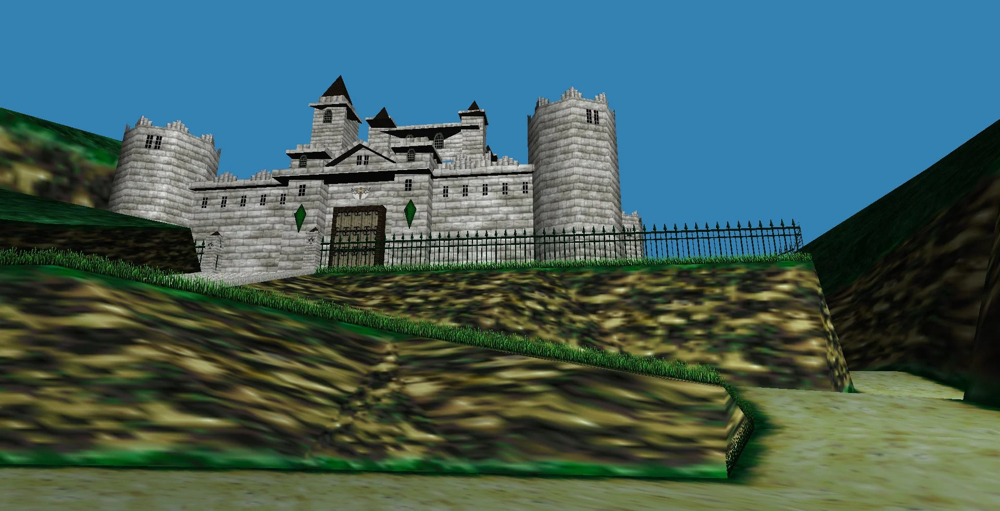
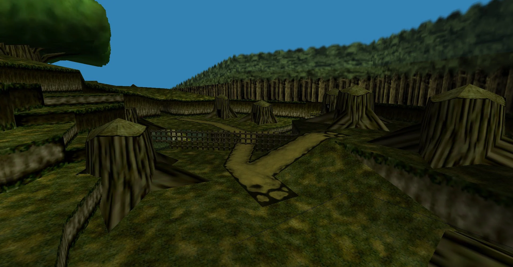

# FZeroX-Zelda64-OverDump

<p align="center">
  
</p>

<p align="center">
  <i>Nintendo 64 development cartridge containing a retail build of F-Zero X and an overwritten early Zelda 64 overdump.</i>
</p>

## Overview

This repository documents a Nintendo 64 development cartridge containing a retail build of **F-Zero X**, with an overdump of a very early version of **The Legend of Zelda: Ocarina of Time**.

The surviving Zelda 64 data is from around the time of Nintendo's **SpaceWorld 1997** tradeshow.

What makes this cartridge unusual is that a substantial amount of the early Zelda 64 data remains intact. The recovered data includes:

- Maps
- Textures
- Text
- Other development resources

Unfortunately, the cartridge was subsequently overwritten with the retail F-Zero X data. As a result, important portions of the original Zelda 64 build are no longer present, including:

- Character models
- Game code
- Audio data

The cartridge was acquired from a former Nintendo employee.

## Zelda 64 Data Location

The surviving Zelda 64 data begins at:

```text
0x1000000
```

This repository documents and preserves the surviving data for further research into the development of **The Legend of Zelda: Ocarina of Time**.

---

## Cartridge

<p align="center">
  
</p>

<p align="center">
  <i>Front of the F-Zero X cartridge containing the surviving Zelda 64 data.</i>
</p>

---

## Recovered Zelda 64 Data

### Asset and Resource Data

<p align="center">
  
</p>

The surviving Zelda 64 data contains a collection of textures, items, interface graphics, text resources, and other development assets.

---

### Castle Environment

<p align="center">
  
</p>

Recovered early Zelda 64 environment data showing a large castle structure and surrounding terrain.

---

### Forest Environment

<p align="center">
  
</p>

Recovered early forest environment data, including tree stumps, terrain, paths, and surrounding forest geometry.

---

## ROM Information

### File Data

```text
System:             Nintendo - Nintendo 64
File:               F-ZERO X [CFZE].z64
BitSize:            256 Mbit
Size (Bytes):       33554432

CRC32:              68FE1CEC
MD5:                95BF2153AAAD6FAFF3FB42FECD2F0200
SHA1:               6AA870EC53602650638B50D7C89CAC026BE481F0
SHA256:             8CEF0E399C0524052B758109ABE894C709A72540A42C4A2118064A5CDDF01B6D
```

### Header Data

```text
Fixed Value 1:      0x8037
Compression Flag:   0x12
Fixed Value 2:      0x400000000F
EntryPoint:         0x00702680
Fixed Value 3:      0x000014
Unknown Value:      0x49
Boot Chip:          CIC-NUS-6106

CRC1:               0xB30ED978 (Ok)
CRC2:               0x3003C9F9 (Ok)

Reserved 1:         0x0000000000000000
Title:              F-ZERO X
Reserved 2:         0x0000000000000000
Serial:             CFZE (USA)
Version:            0x00 (v1.0)
```

---

## ROM Layout

The cartridge is a **256 Mbit Nintendo 64 ROM** containing the retail **F-Zero X** build.

The surviving Zelda 64 data begins at:

```text
0x1000000
```

The Zelda data is therefore embedded within a later F-Zero X ROM image rather than existing as an independently bootable Zelda 64 game image.

Because the later F-Zero X data overwrote portions of the cartridge, the surviving Zelda material represents only a partial snapshot of the original development build.

---

## Historical Context

The surviving data is associated with a very early period in the development of **The Legend of Zelda: Ocarina of Time**, around the time of Nintendo's **SpaceWorld 1997** presentation.

The recovered material provides evidence of development assets and environments that existed during this period. The presence of maps, textures, text, and other resources makes the overdump useful for studying how Zelda 64 was structured during its development.

This should not be interpreted as a complete playable build. The original Zelda executable code, audio, and character models were overwritten by the later F-Zero X data.

---

## Known Surviving Data

| Category | Status |
|---|---|
| Maps | Surviving |
| Textures | Surviving |
| Text | Surviving |
| Environment data | Surviving |
| Item / interface resources | Surviving |
| Character models | Overwritten |
| Game code | Overwritten |
| Audio | Overwritten |

---

## Preservation Notes

The primary purpose of this repository is **historical preservation, research, and documentation** of the surviving Zelda 64 data.

The recovered material should be treated as development-era data rather than a complete playable version of **The Legend of Zelda: Ocarina of Time**.

The surviving resources include maps, textures, text, and other development material, while major portions of the original game were overwritten by F-Zero X.

Further analysis may reveal additional relationships between the surviving resources and other known early Zelda 64 materials.

---

## Internet Archive Record

An archival copy of this material is preserved on the **Internet Archive**:

**[F-Zero X (Zelda 64 Overdump)](https://archive.org/details/f-zero-x-z-64-over-dump.-7z)**

The Internet Archive record identifies the item with the following topics:

```text
N64
Nintendo
Prototype
Development
Debug
Sample
```

The archived item describes the cartridge as a development cartridge containing a retail build of F-Zero X and an overdump for a very early version of **The Legend of Zelda: Ocarina of Time** from around the time of Nintendo's SpaceWorld 1997 tradeshow.

The item description also states that the Ocarina of Time data contains maps, textures, and text, while character models, code, and audio were overwritten by F-Zero X.

The archive record includes the following metadata:

```text
Date referenced in item description: January 19, 2021
Uploaded by: Forest of Illusion
Upload date: October 7, 2022
Item identifier: f-zero-x-z-64-over-dump.-7z
Item size: 21.9 MB
```

The item is included in:

- Forest of Illusion Prototype Collection
- Software History Collection

The Internet Archive record also provides the original reference images and the archived 7Z download.

---

## Repository Contents

This repository contains documentation and reference material related to the surviving Zelda 64 overdump data.

The `/images/` directory contains photographic documentation of the cartridge and screenshots of recovered Zelda 64 material.

### Images

```text
/images/
├── f-zero-x-zelda-64-overdump-cart-front.jpg
├── f-zero-x-zelda-64-overdump-cart-front_thumb.jpg
├── _1.png
├── _2.png
└── _3.png
```

---

## Disclaimer

This repository is intended for historical research, preservation, and documentation of Nintendo 64 development material.

**Nintendo**, **F-Zero X**, **The Legend of Zelda**, and **Ocarina of Time** are trademarks and/or copyrighted works of their respective owners.
